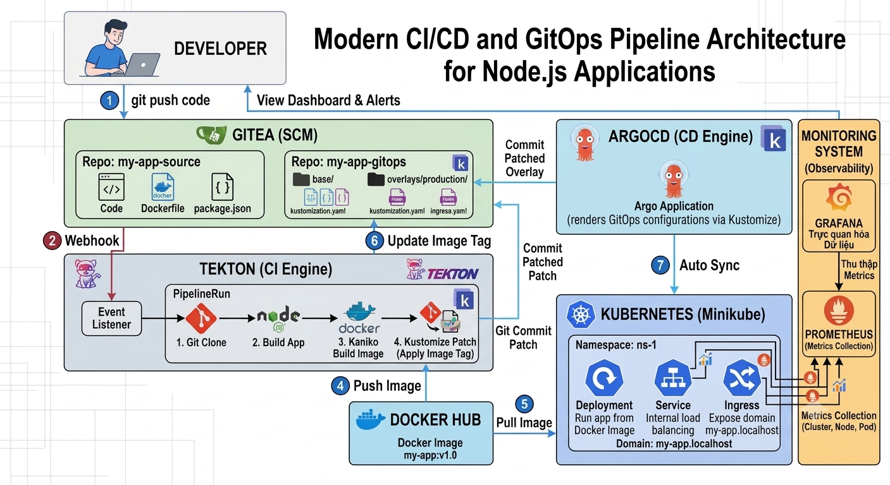
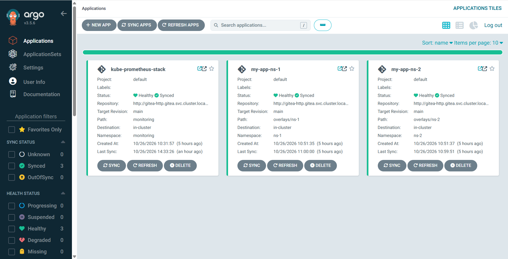
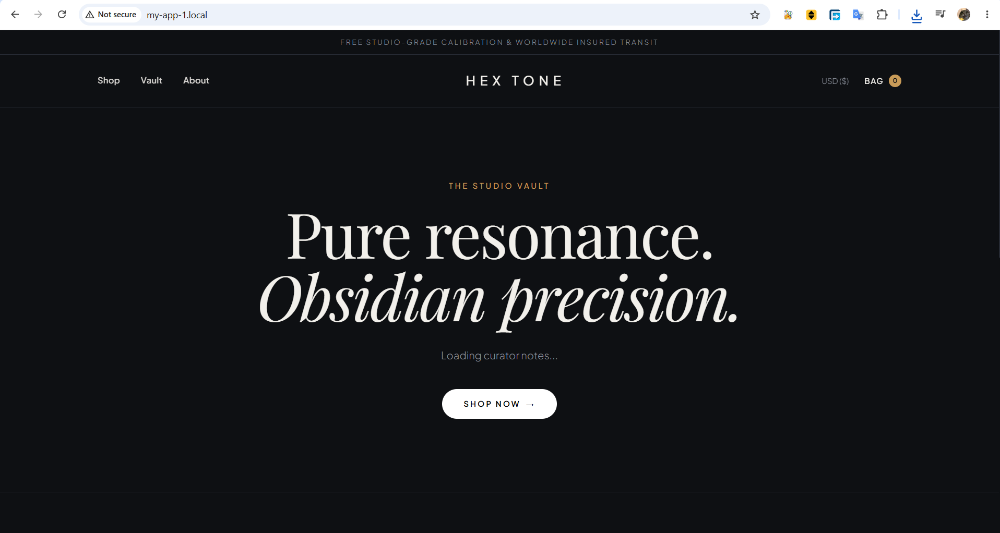
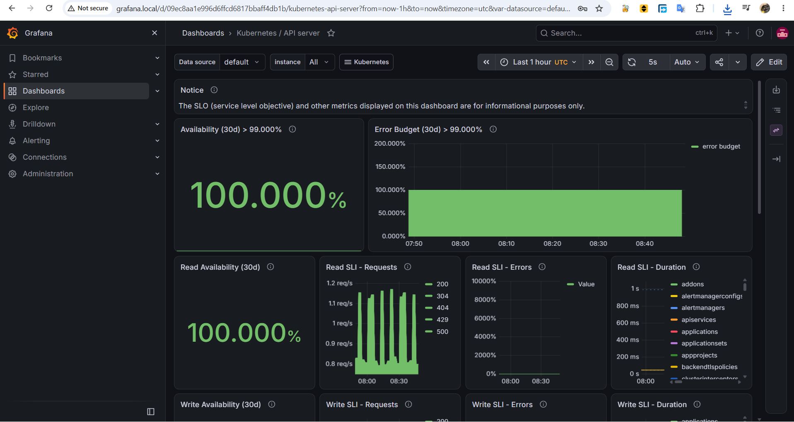

# Automated CI/CD & GitOps Pipeline for Node.js Application

This repository demonstrates a complete modern DevOps workflow, simulating the process from a Developer pushing code to the automatic deployment and monitoring of the application on a Kubernetes cluster.

## 🏗️ Architecture Overview
The pipeline is built with the following stack:
- **Source Control:** Gitea
- **CI Engine:** Tekton (Git Clone -> Build -> Kaniko Push Image -> Update GitOps)
- **Image Registry:** Docker Hub
- **CD Engine:** Argo CD (GitOps, Kustomize, ApplicationSet)
- **Target Cluster:** K3s (running on WSL2)
- **Monitoring:** Prometheus & Grafana

## 🔄 Workflows

1. **Code Push:** Developer pushes code to the `my-app-source` repository.
2. **CI Trigger:** Gitea sends a Webhook to the Tekton EventListener.
3. **Build & Push:** Tekton builds the Docker image and pushes it to Docker Hub.
4. **GitOps Update:** Tekton updates the new image tag in the `my-app-gitops` repository automatically.
5. **CD Sync:** Argo CD detects the change, uses Kustomize to render configurations for multiple environments (`ns-1`, `ns-2`), and syncs them to the K3s cluster.
6. **Monitoring:** Prometheus scrapes metrics, and Grafana visualizes them via dashboards.

## 📸 Project Screenshots

### Continuous Deployment (Argo CD)
*Argo CD automatically syncing the application to the K3s cluster.*

### Application Interface
*The HexTone web application running successfully via Ingress.*

### Monitoring (Grafana)
*Grafana dashboard showing resource metrics from Prometheus.*

## 📁 Repository Structure
- `01-source-code/`: Node.js application source code and Dockerfile.
- `02-gitops-config/`: Kustomize configs (base/overlays) and Helm chart for Monitoring.
- `03-tekton-pipelines/`: Tekton Tasks, Pipelines, and Triggers.
- `04-argocd-config/`: Argo CD Application/ApplicationSet manifests.